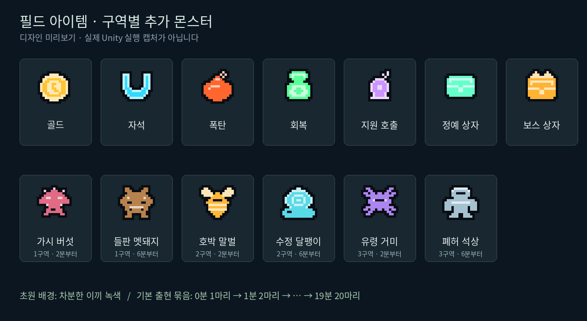

# 필드 아이템 / 분당 증원 / 초원 가독성 업데이트

2026-11-13

골드·자석·폭탄·회복·지원 호출은 서로 다른 픽셀 실루엣과 색상으로 표시합니다. 정예·보스 상자도 전용 아이콘을 사용합니다. 가까운 아이템 하나의 이름과 효과를 화면 하단에 표시하며, 각 아이템에는 색상 바닥 표식을 붙입니다. 아이콘은 종류별로 한 번 생성하고 재사용합니다.

각 구역의 기존 몬스터에 다음 두 종류를 섞습니다. 첫 번째는 2분부터 22%, 두 번째는 6분부터 16% 확률입니다. 6분부터 첫 번째는 22%, 기존 몬스터는 합계 62%를 유지합니다. 정예도 같은 등장 시점을 따릅니다. 새로운 종은 기존 Enemy의 이동·피격·드롭·시간별 능력치 증가를 그대로 사용하며, 전용 픽셀 아트와 기본 체력/속도/접촉 피해를 가집니다.

| 구역 | 2분부터 | 기본 HP / 속도 / 피해 | 6분부터 | 기본 HP / 속도 / 피해 |
| --- | --- | --- | --- | --- |
| 초원 | 가시 버섯 | 24 / 2.25 / 10 | 들판 멧돼지 | 85 / 1.65 / 18 |
| 호박빛 분지 | 호박 말벌 | 22 / 3.6 / 12 | 수정 달팽이 | 95 / 1.25 / 19 |
| 폐허 | 유령 거미 | 30 / 3.2 / 14 | 폐허 석상 | 125 / 1.35 / 23 |

기존 여우·매·정예·보스의 등장 시점은 유지합니다. 20분에는 기존처럼 몬스터를 제거하고 추격자를 등장시킵니다.

## 난이도와 배경

- 매 출현 묶음의 수는 `initialSpawnCount + floor(생존 초 / 60) × spawnCountPerMinute`입니다. 기본값은 매분 +1마리입니다.
- `maximumMinuteSpawnCount` 기본값은 24이며, 현재 20분 전투의 모든 분에서 묶음 크기가 증가합니다. 기본 시작값 1이면 0분 1마리, 1분 2마리, 5분 6마리, 10분 11마리, 19분 20마리입니다.
- 기존 생성 간격 감소, 몬스터 HP/접촉 피해/속도 증가, 정예 빈도 증가를 유지합니다.
- 기존 분당 동시 등장 제한 증가와 절대 상한 220을 유지합니다. 상한에 도달하면 사망으로 자리가 생길 때까지 새 일반 몬스터를 더 만들지 않습니다. 따라서 실제 동시 등장 수가 매분 반드시 증가하는 것은 아닙니다.
- 1구역 바닥은 원래 `groundColor`에 이끼색 `(0.52, 0.63, 0.48)`을 곱하고 풀/장식에도 차분한 녹색을 적용합니다. 원본 초원 텍스처와 풀 배치는 유지합니다.
- 새 수치 필드는 StageData Inspector에서 조절할 수 있습니다. 이전 `extraSpawnEvery`/`maxSpawnCount`는 직렬화 호환을 위해 남기며 현재 캠페인에서는 새 분당 필드를 사용합니다.

## 적용

이 브랜치의 변경 파일을 적용하고 Unity 6000.6.6f1에서 임포트/컴파일을 기다린 뒤 기존 MainScene을 실행합니다. 이번 변경만 적용할 때에는 씬 재생성이나 Apply 메뉴 실행이 필요하지 않습니다. 새 아이콘과 몬스터는 코드에서 생성하므로 새 프리팹 참조 연결도 필요하지 않습니다. 저장 키와 진행 데이터는 변경하지 않습니다.

## 실제 수행한 확인

- 전체 C# 81개 파일의 tree-sitter 문법 검사: 오류 없음. Unity 타입 검사/컴파일 결과가 아닙니다.
- 새 아이템 아트 7종, 몬스터 아트 6종의 패턴·투명도·서로 다른 픽셀 확인. 위 이미지는 런타임 패턴과 같은 방식으로 렌더링한 디자인 미리보기입니다.
- 새 C#의 .meta 존재와 GUID 중복 여부, 현재 Stage 3개의 기본 출현 값으로 20분 전까지 매분 증가 가능한지 확인.
- `git diff --check`: 통과.
- 기존 `verify_sources.py`는 현재 저장소에 없는 `Art/Weapon0.png`를 요구하여 중단되었습니다. 전체 기존 검사 통과로 보고하지 않습니다.
- 이 환경에 Unity Editor와 unity CLI가 없어 Unity 컴파일, 추가 EditMode/PlayMode 테스트 실행, 실제 플레이/화면/성능 확인은 미실행입니다.

## Unity에서 확인할 항목

1. Test Runner에서 `EncounterReadabilityTests`, `PickupEncounterTests` 실행. 테스트 저장은 임시 메모리 프로필을 사용합니다.
2. 상자를 반복 파괴하여 5종 아이템의 실루엣, 바닥 표식, 가까운 아이템 이름/효과를 확인합니다. 자석·폭탄·회복·지원·상자 보상이 기존처럼 작동하는지 확인합니다.
3. 각 구역에서 1분 경계 출현량과 2분/6분 신규 종을 확인합니다. Console의 `[Pixel Survivor] Stage … minute … spawn batch=… density cap=…`를 확인합니다.
4. 1구역에서 화면 가장자리, 풀이 있는 곳, 전투 이펙트가 겹친 곳의 몬스터 대비를 확인합니다.
5. 정지/레벨업/상자에서 생존 시간과 분당 증가가 멈추고, 재시작 시 초기화되는지 확인합니다.
6. 10분 보스, 20분 추격자/해금이 유지되는지 확인합니다. 후반 15~19분의 FPS와 GC 할당, 목표 PC 난이도를 확인합니다. 실제 성능·밸런스 조정은 이 검증 뒤 필요할 수 있습니다.
